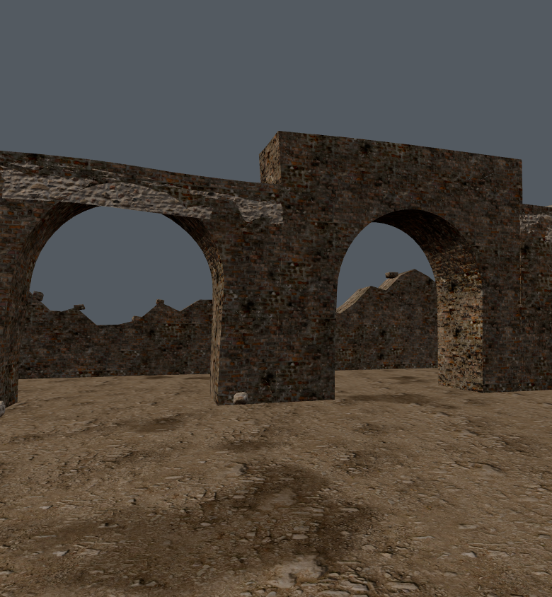
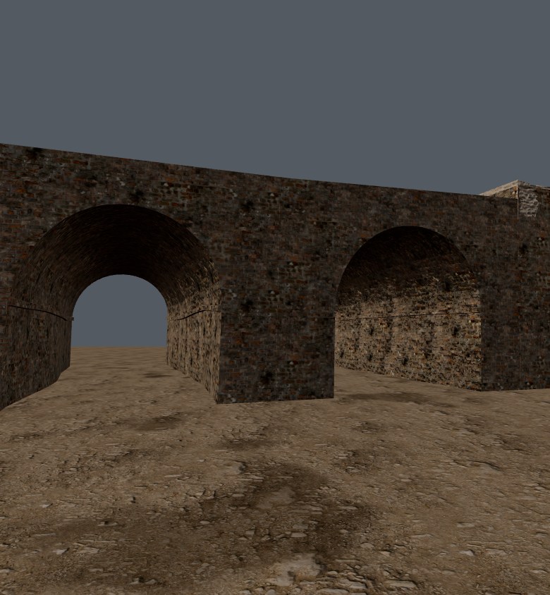
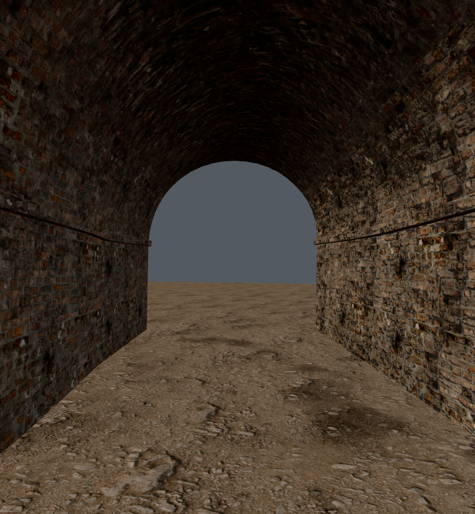

# Porticus Romanae: map correction validation

The Santi Quaranta anchor remains at world (−548, −392), with its existing rotation and site terrace. The live world no longer builds the unsupported catacomb network, ossuary chapel, bone shelves or martyr's memoria. Their two stair holes, culling zones and Catacumbae/Crypta teleports are removed. The site and arrival display as **Porticus Romanae**. This is a corrected interpretation of the existing Roman site, not a relocation or a connection to other underground spaces.

The Roman ruin frontage retains six bays. Two bays now continue into 14 m open-ended barrel-vaulted passages; the other bays remain short ruined arches. The continuous existing terrain supplies the walkable floor, so no new ground hole or elevated floor collision is required. Detached remnants and fallen architectural pieces leave both entrances/exits clear.

The source supports vaulted Roman galleries and probable public pedestrian circulation. Bay count, dimensions, surviving elevations and their AD 700 condition remain **reconstruction hypotheses**, not a surveyed reconstruction. See [HISTORY.md](../HISTORY.md#underground-passages-direct-online-source-check).

## Matched geometry inspection

Same camera, lighting and production surface materials; an isolated ground plane replaces the rest of the city. The control includes the former above-ground ruins, chapel and memoria, but excludes the old underground catacomb mesh and separately instantiated bone props. These images verify the passage geometry, not the complete game's atmosphere or performance.

| Before | After |
|---|---|
|  |  |

Inspected results: both passages have continuous arched soffits, connected walls and open ends. The interior sightline remains unobstructed. The change replaces shallow facade arches with traversable covered volume; it does not claim a newly documented historical plan.

## Checks

- TypeScript check passed after the geometry changes; root's integration build also passed after the final naming change.
- Twelve collision rays cover both passage routes at head and waist height, at the centreline and ±35 cm laterally. No obstruction was found. This checks the local gallery geometry; it is not a complete player traversal test including all world props.
- Local replacement site: 17,882 authored render triangles across three materials; zero bone props or lamps. No funerary teleports remain.
- Matched isolated exterior view: 29,872 rendered triangles / 7 calls before; 13,346 triangles / 5 calls after. Interior view: 13,346 / 5. These are isolated scene counters, not whole-world or iPhone performance measurements.
- Browser reported no page errors during the successful captures. The first complete-world baseline attempt timed out; no successful full-world before screenshot is claimed here. Root runs the combined world checks separately.

Machine-readable results: [geometry and collision](geometry-check.json), [isolated renderer](render-check.json). Reproduce with a fresh Vite server, then `python tools/capture-porticus.py --url http://127.0.0.1:5173`. The script generates the old control from pinned repository commit `9200a4ac1282c0d5fb23930b40e57c4adc970ff5`, captures the current geometry through `tools/porticus-audit.html`, and fails on browser errors. Run `npx tsx tools/check-porticus.ts` for the local collision and naming checks. These are development tools, not game entry points.

### Combined-world check limitation

The final production build passed, including the renamed Porticus Romanae NPC
anchor. A 390×844 production-browser smoke attempt at Curtis timed out after
240 seconds waiting for the screenshot-ready flag. It produced no accepted
whole-world capture or counters; the earlier baseline attempt also timed out.
This does not establish the cause and is not a passing world/iPhone performance
check. The isolated renders and local passage collision checks above did pass.
