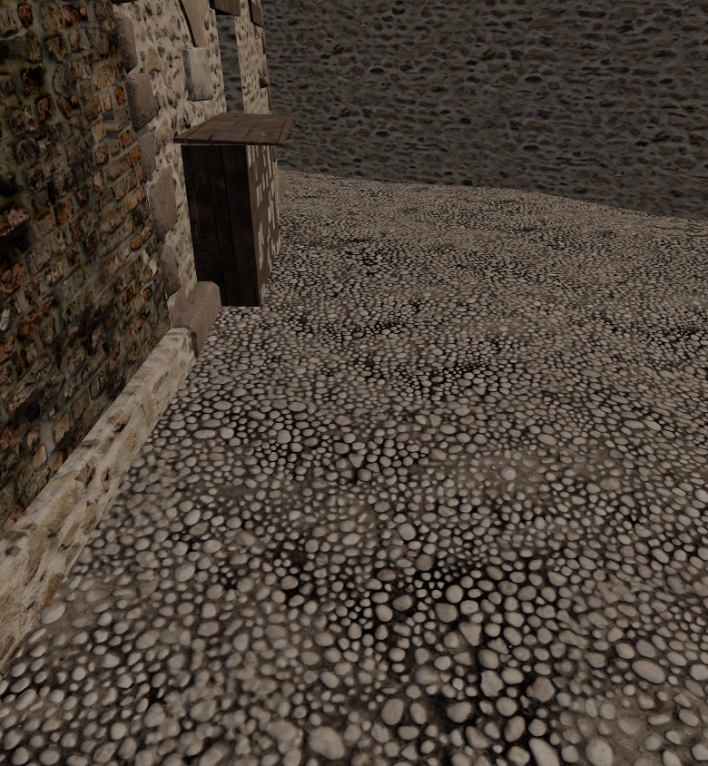
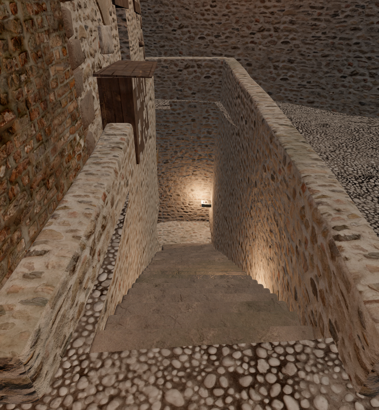
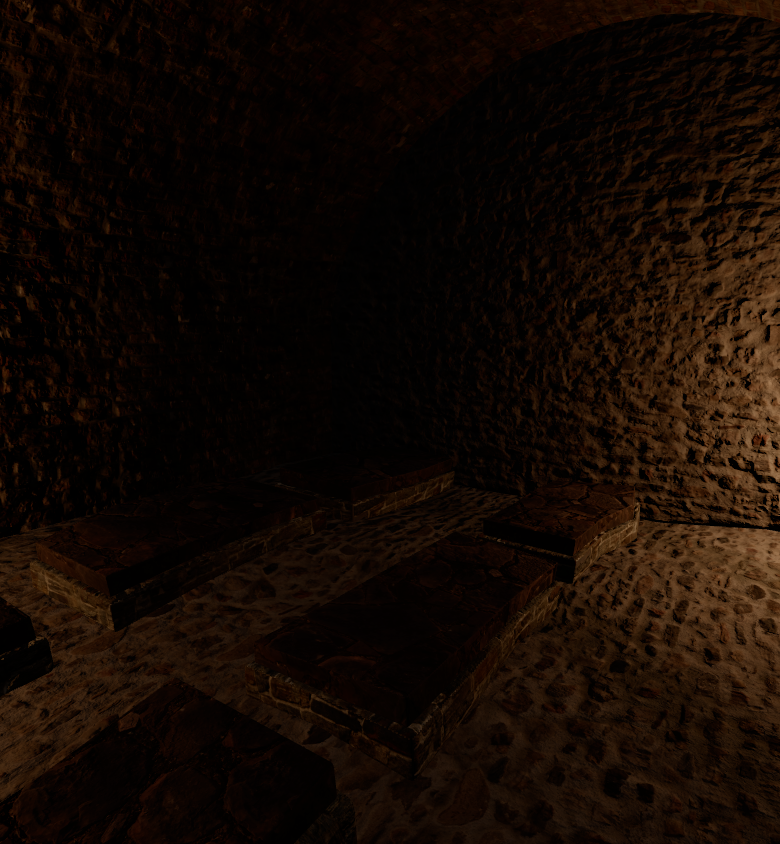

# Triggio-inspired burial chamber: placement and validation

A compact underground burial room and entry bay now occupy the ground beneath existing lot965. Its street-side stair opens from the north, inside the town, and descends before reaching the existing southern wall. The wall, house footprint and street route remain intact. No subterranean network connects this chamber to other sites.

The modern Living Museum pin converts to approximately world(8.98,87.54), outside the game's AD700 wall mask and with no registered built parcel nearby. The chosen access lies about100m north-east, at the nearest existing built frontage. Site origin is(55.210952,−5.624151), rotated−0.066293rad; the local stair mouth is(−1.25,−5.2) and the surface arrival(−1.25,−6.4). This is an explicitly authorized **plausible reconstruction**, not the excavated plan or exact ancient access of the museum. Sources and chronological limits remain in [UNDERGROUND-RESEARCH.md](../UNDERGROUND-RESEARCH.md) and [HISTORY.md](../HISTORY.md); uncertainty labels are not inserted into the game.

The six low stone cists, cover slabs, one ceramic vessel and four supported oil lamps form a restrained funerary chamber. The inner room is approximately6.4×5.6m, with a reused masonry barrel vault, a short entry bay and a26-tread stair descending5.2m. It has no skull shelves, stacked loculi or invented connecting tunnels. The floor, end walls and roof have collision. A single horizontal construction datum aligns the lower room and its readable.

The original4.5m lane retains approximately2m beside the retaining wall. A0.2m sampling grid over the stair opening found no overlap with any existing lot polygon. The initial southern approach was rejected because actual town-wall collision blocked it; reversing the stair preserves that wall and provides working entry from the city side.

## Matched visual inspection

The fixture includes two actual town chunks and identical camera/material/light settings for the before/after surface views. It uses the real production ground-hole and collision builder. It omits NPCs and the full game's postprocessing, streaming/culling and dynamic lighting selection; whole-world validation is separate.

| Before | After |
|---|---|
|  |  |

The inspected views show a continuous stair, supported retaining walls and an enclosed vaulted room with low individual graves. The room is deliberately dim in this isolated oil-lamp lighting; the final game lighting and player-lantern view require the separate world audit.

## Real controller traversal

This is not only a ray test. The fixture instantiates the actual `Player` capsule controller against the neighboring town colliders, new burial masonry, smooth stair ramp and **production `groundCollider`**, which uses0.5m cells around the opening. Six waypoints drive the controller down the stairs, through the doorway, along the chamber aisle, back through the doorway and up to the surface.

| Leg | Simulation frames at60Hz | Final horizontal error | Eye height relative to datum |
|---|---:|---:|---:|
| Descend | 99 | 0.085m | −3.529m |
| Enter chamber | 70 | 0.179m | −3.538m |
| Cross chamber | 102 | 0.153m | −3.594m |
| Return to entrance | 103 | 0.162m | −3.541m |
| Return to stair | 68 | 0.145m | −3.524m |
| Ascend to surface | 263 | 0.158m | +1.734m |

All legs completed without teleporting between them. Browser page/console errors were empty. Local ray tests additionally found no obstruction on18 head/waist path segments and confirmed floors under all sampled positions.

## Geometry and rendering counters

- New module alone: **22,146 triangles, seven material slots, four lamps, no skeletal props**. Material slots are not a whole-world draw-call count; the Builder pools/splits geometry by spatial cells.
- Matched surface fixture:84,660 triangles/15calls before;106,732/22 after.
- Interior fixture:99,957 triangles/18calls, including the surrounding two town chunks. This fixture does not apply production underground culling, so these are not final game budgets.
- No iPhone frame-time claim follows from these desktop software-renderer checks.

Machine-readable evidence: [geometry/opening checks](geometry-check.json), [rendering and controller traversal](render-and-traversal.json).

Reproduce with a fresh Vite server: `python tools/capture-triggio-burials.py --url http://127.0.0.1:5173`. The tool captures matching views and fails on browser errors, blocked traversal, incorrect burial floor level or failure to return to the surface. Run `npx tsx tools/check-triggio-burials.ts` for the local geometry/opening checks.
